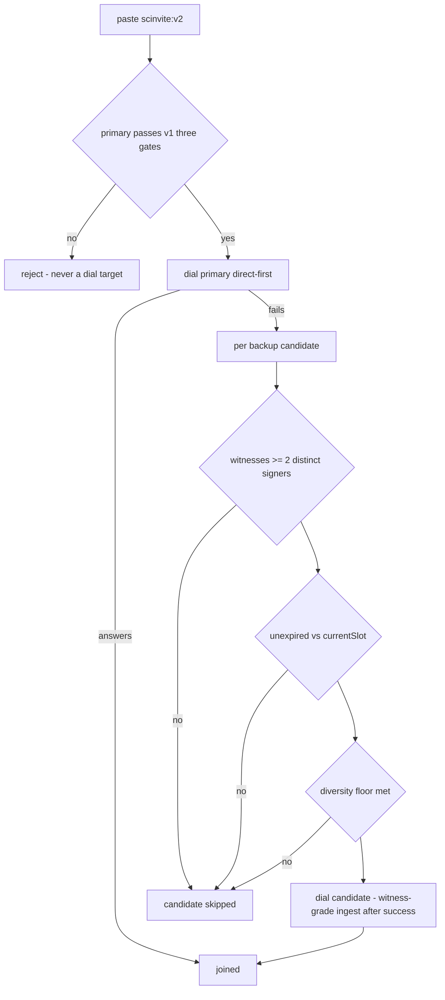
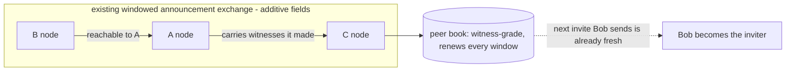

# Witness flow diagrams (scinvite:v2)

Companion to `spec-scinvite-v2.md`. Diagrams only; normative text lives in the kernel.

## mint → redeem with an offline inviter (WB-1/2/3)

```mermaid
sequenceDiagram
    participant B as Backup relay R
    participant W as Witnessing peers
    participant A as Alice (inviter, later offline)
    participant T as Text message
    participant V as Bob (fresh, CGNAT)

    W->>A: probe/dial success → signed ReachabilityWitness(A.addr, expirySlot)
    A->>A: also holds circuit via R → witness(R.circuitAddr) from its peers
    Note over A: Alice mints the bundle while still online
    A->>T: scinvite:v2 = primary record + backups[R] + witnesses (all signed)
    Note over A: Alice closes the laptop — offline at redemption
    V->>T: paste invite
    V->>V: gate 1-3 on PRIMARY (v1 verbatim; empty-chain rule may allow)
    V->>V: per backup: ≥2 distinct signers, expiry vs currentSlot, diversity floor
    V->>R: dial primary first; on failure dial witnessed candidate
    R-->>V: circuit to the network (chain sync begins)
```

## verification decision (WB-3, WB-6)



## self-refreshing knowledge (WB-4)



Note: no new protocol — witnesses ride announcement gossip; nodes that predate v2 ignore the fields (proto3 unknown-field tolerance, pinned by a WB-4 row).
